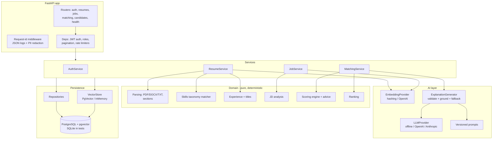
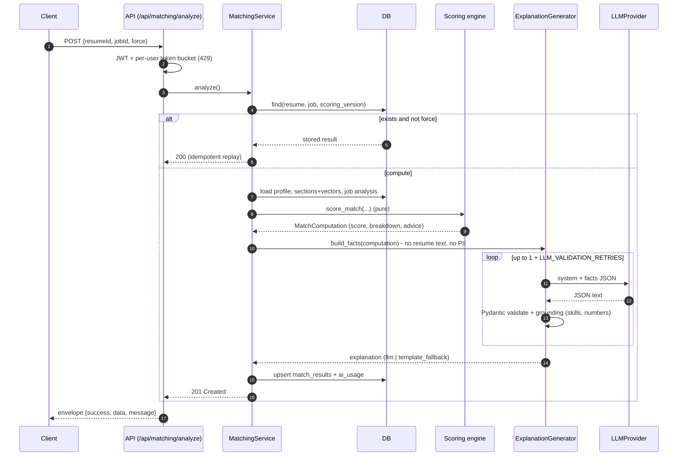
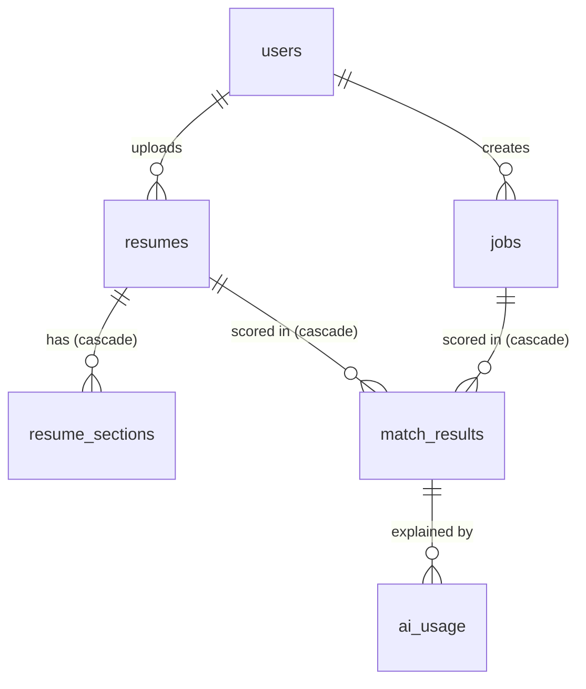

# Architecture

## Components

Dependencies point inward: `domain/` imports nothing from FastAPI, SQLAlchemy or the AI
layer, which keeps the scoring engine trivially unit-testable and deterministic.

## Analyze sequence

## Ranking

`GET /api/candidates/ranking` loads the candidate pool (all resumes, or the top
`RANKING_CANDIDATE_POOL` by vector similarity when there are more), batch-computes any
missing matches for the current scoring version using the deterministic narrative
(`explanation.source = deferred_template`, no LLM calls), sorts with deterministic
tie-breaks (score, required coverage, semantic, upload time, id) and paginates. Opening a
batch result through `POST /api/matching/analyze` later attaches the LLM narrative without
touching the score.

## Persistence

* `resume_sections.embedding` and `jobs.embedding` are `vector(512)` on PostgreSQL (HNSW,
  `vector_cosine_ops`) and JSON arrays on SQLite via a `TypeDecorator`.
* JSON documents (`profile`, `analysis`, `result`, `explanation`) are JSONB on PostgreSQL.
* The Alembic migration is hand-written; `tests/integration/test_migrations.py` asserts it
  produces exactly the ORM's tables and columns, and the `postgres`-marked tests run it
  against a real pgvector database.

## Cross-cutting

* **Errors**: `AppError` subclasses map to status codes; a global handler renders
  `{success:false, message, errors[], traceId}` for app, validation, HTTP and unhandled
  errors.
* **Logging**: one JSON line per record with `request_id`; a logging filter redacts
  e-mails, phone numbers and profile URLs from messages, args and extras.
* **AI usage**: providers emit `UsageRecord`s (provider, model, prompt version, latency,
  tokens, estimated cost, success, attempt) into a context-scoped collector; the service
  persists them to `ai_usage`. No prompt or resume content is stored or logged.
