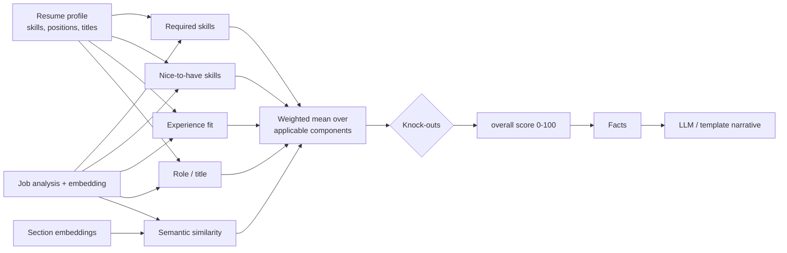

# Scoring model

> The score is **deterministic + semantic**. The LLM writes the narrative from the computed
> facts and never changes the number.

Source: `src/resume_matching/domain/scoring/`. Every tunable value lives in
`ScoringSettings` (`src/resume_matching/core/config.py`, env prefix `SCORING_`).

## Pipeline



## Components (each 0-100, or *not applicable*)

| Component | Default weight | How it is computed |
|---|---:|---|
| Required skills | 0.40 | Weighted coverage of `critical` + `required` requirements. Exact or alias hit = 1.0 credit, *related* skill only = `SCORING_RELATED_SKILL_CREDIT` (0.5), missing = 0. `critical` requirements weigh `SCORING_CRITICAL_SKILL_WEIGHT` (2.0) vs 1.0. Explicit skills that are not in the taxonomy are matched literally with the same boundary rules. |
| Nice-to-have skills | 0.10 | Unweighted coverage of `nice_to_have` requirements, same credit rules. |
| Experience | 0.20 | Piecewise-linear curve of `r = candidate_years / min_years`: `0 -> 0`, `0.5 -> 40`, `1.0 -> 90`, then `+20` per extra multiple, capped at 100. More experience never lowers the score. |
| Role / title | 0.10 | `0.7 * title_similarity + 0.3 * seniority_fit`. Title similarity mixes token overlap of normalised titles (synonyms: developer = engineer, back-end = backend) with role-family affinity (backend, ml_ai, data, ...). Seniority fit is 1.0 on target, 0.9 / 0.8 above, 0.6 / 0.3 / 0 below. |
| Semantic | 0.20 | Cosine between the JD embedding and each scored resume section; `raw = 0.7 * max + 0.3 * mean`, linearly rescaled from `[floor, ceiling]` to `[0, 100]`. Calibration is per provider: hashing `[0.05, 0.45]`, OpenAI `[0.20, 0.70]`. |

A component is **not applicable** when it has no data (no nice-to-haves in the JD, no
minimum years, no embeddings). Its weight is redistributed proportionally over the
applicable components, so a JD without nice-to-haves is not penalised.

```
overall_raw = sum(w_i * s_i for applicable i) / sum(w_i for applicable i)
overall     = min(overall_raw, caps of triggered knock-outs)
```

## Knock-outs

| Code | Trigger | Cap |
|---|---|---:|
| `missing_critical_skill` | Any `critical` requirement with no exact, alias, related or literal match | 40 |
| `insufficient_experience` | `candidate_years < 0.5 * min_years` | 60 |

Both the raw and capped score are returned (`rawScore`, `matchPercent`), so a recruiter can
see that a strong profile was capped by one missing must-have.

## Worked example (real run, `docs/api-examples.md`)

Daniel Okafor (sample resume) vs *Senior AI Backend Engineer (Python/FastAPI)*:

| Component | Score | Weight | Contribution |
|---|---:|---:|---:|
| Required skills (16/17, 1 via related) | 97.4 | 0.40 | 38.95 |
| Nice-to-have (2/4) | 50 | 0.10 | 5.00 |
| Experience (8.4 vs 5+ years) | 100 | 0.20 | 20.00 |
| Role / title | 76.2 | 0.10 | 7.62 |
| Semantic (best: experience, raw cosine 0.405) | 88.8 | 0.20 | 17.77 |
| **Overall** | **89.3** | | strong |

The .NET sample resume against the same JD has a raw score of 49.3 but misses the two
critical skills (Python, FastAPI), so it is capped at **40.0**.

## JD analysis

Implemented in `domain/job_analysis.py`:

1. Explicit lists in the request (`criticalSkills`, `requiredSkills`, `niceToHaveSkills`)
   win for the skills they name.
2. In the text, each skill occurrence is classified by the cue in its clause ("must have"
   -> critical, "required" -> required, "nice to have", "a plus", "bonus", "preferred" ->
   nice-to-have), else by the current block heading ("Requirements:", "Nice to have:").
   A clause such as "Docker is required, Kubernetes is a plus" is split at commas.
3. Across occurrences the strongest classification wins; un-cued mentions count as
   required (an unhedged technology in a JD usually matters).
4. Minimum years: explicit value, else the largest "N+ years" figure in the text.

## Versioning and idempotency

`scoring_version = "<algorithm semver>+<sha256(ScoringSettings, embedding model id, taxonomy version)[:8]>"`,
for example `1.0.0+deeb6dad`. Changing any weight, the embedding model or the taxonomy
produces a new version, so `POST /api/matching/analyze` computes a new result instead of
silently returning one computed under different rules. Results are unique per
`(resume_id, job_id, scoring_version)`.

## Determinism

Scoring is a pure function of the stored profile, job analysis, stored vectors and
settings: no clock, no randomness, no network. The hashing embedder uses BLAKE2b (not
Python's salted `hash()`), so vectors are identical across processes. Tests assert equal
output for repeated runs.

## Fairness

The scorer only sees the structured profile (skills, dated positions, titles) and the
embeddings of *scored* sections. The resume header (name, contact details, address,
photo captions) and personal sections (interests, languages, references, volunteering) are
excluded by construction. Embedding inputs are PII-redacted and four-digit years are masked
(graduation years are an age proxy). Over-qualification is never penalised. A test asserts
that changing the name, e-mail, phone, address and adding a personal section leaves every
component score unchanged.
